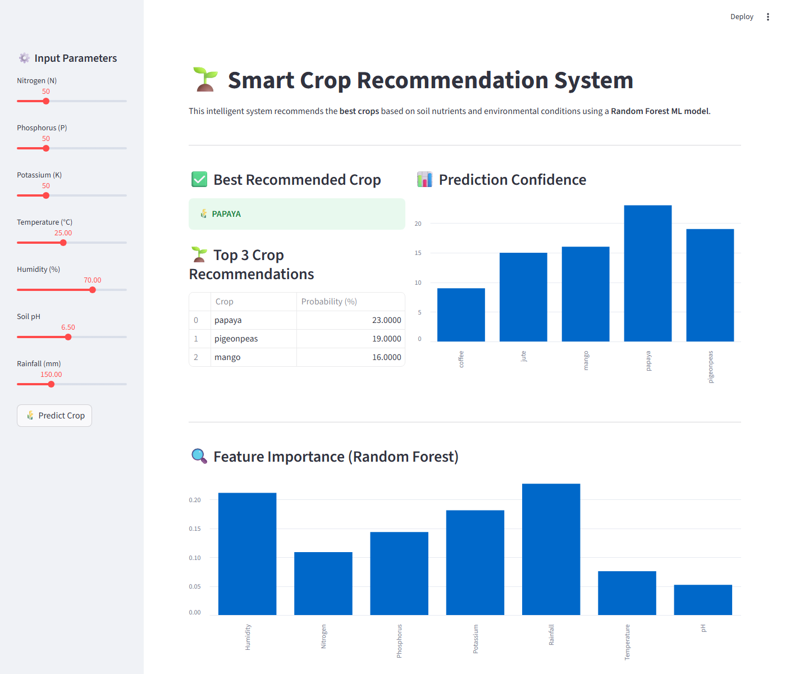
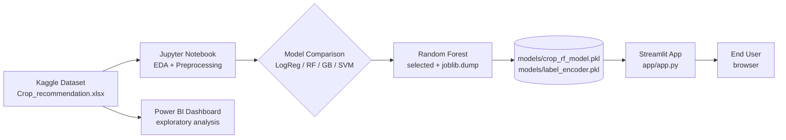
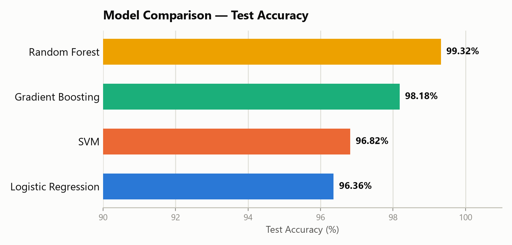
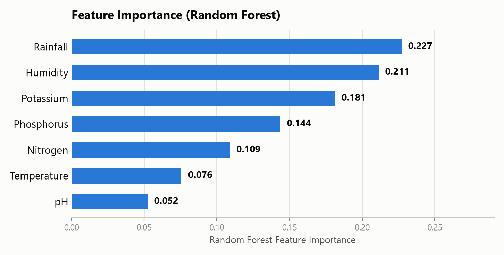
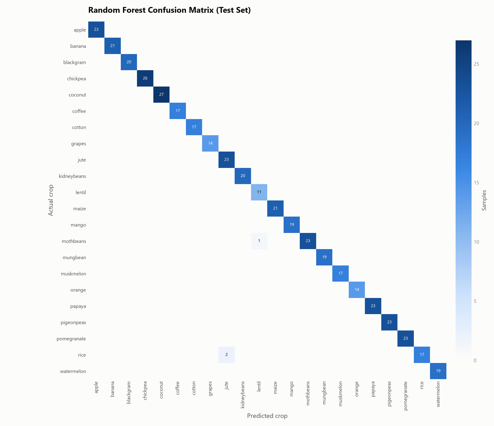

# 🌱 Smart Crop Recommendation System


A machine learning system that recommends the most suitable crop for a plot of
land based on its soil nutrients (N, P, K) and climate conditions (temperature,
humidity, pH, rainfall).



## Table of Contents

- [Project Overview](#project-overview)
- [System Architecture](#system-architecture)
- [Features](#features)
- [Technologies Used](#technologies-used)
- [Project Structure](#project-structure)
- [Installation](#installation)
- [Benchmark Evaluation](#benchmark-evaluation)
- [Experimental Results](#experimental-results)
- [Methodologies](#methodologies)
- [Limitations](#limitations)
- [Future Improvements](#future-improvements)
- [License](#license)
- [Authors](#authors)

## Project Overview

Farmers often decide what to grow based on experience and guesswork rather
than data, which can lead to poor yields. This project analyzes soil and
weather data to recommend the crop best suited to a given set of conditions,
and ships two complementary artifacts:

- A **Streamlit web app** that takes live soil/climate input and returns a
  ranked crop recommendation with explainable feature importances
- A **Power BI dashboard** for exploring the underlying dataset

The dataset ([Kaggle – Crop Recommendation Dataset](https://www.kaggle.com/datasets/atharvaingle/crop-recommendation-dataset))
contains 2,200 records across 22 crop classes, with:

- Soil nutrients: Nitrogen (N), Phosphorus (P), Potassium (K)
- Temperature, Humidity, Soil pH, Rainfall

## System Architecture



The notebook is the single source of truth for the model: it trains and
compares four classifiers, then persists the winning Random Forest and its
label encoder directly into `models/`, which the Streamlit app loads at
startup. There is no separate, undocumented training step — running the
notebook end-to-end reproduces exactly what the app serves.

## Features

- ML-powered crop recommendation with ranked probabilities, not just a single label
- Feature importance breakdown so predictions are explainable, not a black box
- Interactive Streamlit web app with live sliders for every input
- Reproducible training notebook that persists the exact model the app uses
- Power BI dashboard for exploring the underlying dataset

## Technologies Used

- **Python 3.10+**
- **Streamlit** – web app / frontend
- **scikit-learn** – model training and evaluation
- **Pandas & NumPy** – data handling
- **Joblib** – model serialization
- **Power BI** – dataset exploration and dashboards

## Project Structure

```
crop-recommendation/
│
├── app/
│ └── app.py                     # Streamlit application
│
├── models/
│ ├── crop_rf_model.pkl          # Trained Random Forest (joblib)
│ └── label_encoder.pkl          # Crop label encoder (joblib)
│
├── data/
│ └── Crop_recommendation.xlsx
│
├── notebooks/
│ └── Crop_recommendation.ipynb  # EDA, model comparison, model persistence
│
├── powerbi/
│ └── Crop recommendation.pbix
│
├── assets/
│ └── app_screenshot.png
│
├── .scripts/                    # local dev helpers (not part of the app)
├── requirements.txt
├── LICENSE
├── .gitignore
└── README.md
```

## Installation

### 1. Create a virtual environment (recommended)

```bash
python -m venv venv
source venv/bin/activate   # Windows: venv\Scripts\activate
```

### 2. Install dependencies

```bash
pip install -r requirements.txt
```

### 3. Run the Streamlit app

From the **project root directory**:

```bash
streamlit run app/app.py
```

The app opens automatically in your browser at `http://localhost:8501`.
Adjust the sidebar sliders for N, P, K, temperature, humidity, pH, and
rainfall, then click **🌾 Predict Crop** (it also predicts on the default
values automatically on load).

### 4. Open the Power BI dashboard (optional)

1. Open the `.pbix` file from `powerbi/` in **Power BI Desktop**
2. Connect to the dataset in `data/` if prompted
3. Refresh data to explore crop distribution, nutrient trends, and
   rainfall/temperature/humidity analysis

## Benchmark Evaluation

Four classifiers were benchmarked on an identical **80/20 train-test split**
(`random_state=42`) so results are directly comparable:

- **Logistic Regression** and **SVM** are distance/scale-sensitive, so both
  are wrapped in a `Pipeline` with `StandardScaler` — evaluating them on raw,
  unscaled features would have unfairly penalized them against the tree-based
  models.
- **Random Forest** and **Gradient Boosting** are trained on raw features,
  since tree splits are scale-invariant.
- All four are scored on the same held-out test set using **accuracy,
  weighted precision, weighted recall, and weighted F1** (weighted to account
  for the 22-class multi-class setting).

## Experimental Results

| Model               | Accuracy   | Precision | Recall | F1-Score |
|---------------------|-----------:|----------:|-------:|---------:|
| Logistic Regression | 96.36%     | 96.44%    | 96.36% | 96.35%   |
| SVM                 | 96.82%     | 97.15%    | 96.82% | 96.80%   |
| Gradient Boosting   | 98.18%     | 98.43%    | 98.18% | 98.19%   |
| **Random Forest**   | **99.32%** | **99.37%**| **99.32%** | **99.32%** |



**Random Forest** wins on every metric and is the model shipped in the app.
Its feature importances rank **rainfall** and **humidity** as the two most
influential inputs, followed by potassium and phosphorus — consistent with
agronomic intuition about water availability driving crop suitability.



The Random Forest confusion matrix is almost perfectly diagonal on the
440-sample held-out test set; its only errors are between agronomically
similar crops — 1 *mothbeans* sample misclassified as *lentil*, and 2 *rice*
samples misclassified as *jute* (both pairs share overlapping soil/climate
profiles).



## Methodologies

1. **EDA** – shape, dtypes, missing-value check, univariate distributions,
   and a correlation heatmap over the numeric features.
2. **Preprocessing** – target label encoding (`LabelEncoder`); no missing-value
   imputation was needed since the dataset has none.
3. **Train/test split** – 80/20 split with a fixed `random_state` for
   reproducibility.
4. **Model training** – four classifiers trained under identical split
   conditions (see [Benchmark Evaluation](#benchmark-evaluation)).
5. **Evaluation** – confusion matrix, accuracy, precision, recall, and
   F1-score computed per model on the same test set.
6. **Model selection** – Random Forest chosen based on top scores across all
   four metrics.
7. **Persistence & deployment** – winning model and label encoder saved via
   `joblib.dump(...)` into `models/`, loaded directly by `app/app.py` with
   `st.cache_resource`.

## Limitations

- The dataset is a **controlled/benchmark dataset** (~100 samples per crop),
  not live field or sensor data, so real-world accuracy may differ from the
  99.32% test-set figure.
- **No cross-validation or hyperparameter tuning** yet — results come from a
  single train/test split; a `GridSearchCV`/`cross_val_score` pass would give
  a more robust estimate.
- The model **cannot fully separate agronomically similar crops** (e.g.
  mothbeans vs. lentil, rice vs. jute) whose soil/climate profiles overlap.
- Recommendations are **purely numeric-feature-based** — there's no
  geographic, seasonal, soil-type, or crop-rotation context.
- No **yield, cost, or market-price** dimension — the system recommends
  suitability only, not profitability.

## Future Improvements

- Cross-validation and hyperparameter tuning (`GridSearchCV`) for Random Forest
- SHAP-based per-prediction explanations ("why this crop, specifically")
- Real-time weather data integration
- Fertilizer recommendation as a follow-on feature
- Automated tests, CI, and a hosted live demo

## License

Licensed under MIT.

## Authors

1. Hency Babariya
2. Yashu Bopanna P D
3. Manoj Kumar
4. Mohan Krishna

Dataset credit: [Crop Recommendation Dataset on Kaggle](https://www.kaggle.com/datasets/atharvaingle/crop-recommendation-dataset)
